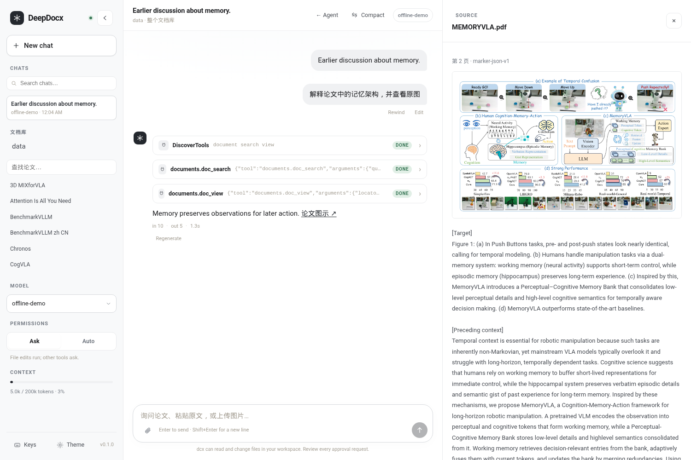

<!-- Generated language panels. Edit this file's default-open language, then run python scripts/sync_doc_languages.py. -->

<details name="deepcodocx-doc-language" lang="zh-CN">
<summary>简体中文</summary>

<!-- doc-language:zh-CN:start -->
# DeepCodocx


**代码、论文与图表，一个 Agent 工作区。**

[](https://github.com/wpx147258/DeepCodocx/actions/workflows/ci.yml)
[](pyproject.toml)
[](LICENSE)

DeepCodocx 让 Agent 在代码仓库和文档资料之间工作：运行命令、修改文件、定位论文原文、
查看图表，再把依据交还给你。终端、浏览器和自动化脚本共用同一个 Agent 运行时。

在 **DeepDocx 文档模式**中，连接已转换的文档库，便可围绕论文概念、原文片段和图表展开
讨论。文档能力通过渐进式上下文与按需发现的 MCP 工具提供；Agent 自主决定如何组合
搜索、阅读、看图，以及原生 Bash / Read 工具。



[暗色界面](docs/web/deepdocx-dark.png) · [移动端](docs/web/deepdocx-mobile.png) ·
[普通 Agent 工作区](docs/web/chat-light.png)

## 有什么值得一试

- **从答案回到依据。** 点击来源，打开对应的原文、页面或图表；定位信息保留文档版本、
  解析产物和页码。
- **代码与文档工具自由组合。** 内置文件与 Shell 工具，配合按需发现的本地 MCP 能力；
  需要哪些证据、下一步做什么，由同一个 Agent 决定。
- **讨论可以持续。** 保存与恢复会话、fork 已有讨论、压缩长上下文；编辑重发前可以预览
  Write / Edit 的文件变更并选择恢复方式。
- **执行过程看得见。** 流式回复、工具输入输出、审批提示、用量与上下文读数，集中在
  一个轻量 Web 界面中。也支持终端交互和 JSON / JSONL 脚本接口。

## 几分钟开始

需要 Python **3.12+** 和 [uv](https://docs.astral.sh/uv/)。以 DeepSeek 为例：

```bash
git clone https://github.com/wpx147258/DeepCodocx.git
cd DeepCodocx
uv sync

export DEEPSEEK_API_KEY="your-api-key"
uv run cli-agent web --provider deepseek
```

浏览器打开终端显示的地址，默认是 `http://127.0.0.1:8765/`。WSL 或无图形桌面环境可加
`--no-open`；端口被占用时加 `--port 8766`。

当前可执行命令为 `cli-agent`，Python 包名为 `dcx`。Anthropic、DeepSeek、Kimi、MiniMax、
GLM 的 Anthropic-compatible 接口有内置配置，更多选项见[配置指南](docs/configuration.md)。

## 带上你的文档库

点击 **DeepDocx**，选择全新会话或 fork 当前讨论，再连接已有的 basic / Marker bundle
目录。可以限定论文范围，选择会跨重启保存。

也可以直接从文档模式启动：

```bash
uv run cli-agent web --provider deepseek --library /path/to/paper-bundles
```

先定位论文，再阅读相关段落、查看原图、结合证据解释——这些操作都可以在同一段讨论中
自然衔接。已有可用的文档库会自动选中，详细输入格式与操作方式见
[DeepDocx 文档指南](docs/deepdocx.md)。

界面示例使用预处理论文与脚本 provider 生成；实际回答效果取决于所选模型及文档质量。

## 喜欢终端或脚本？

```bash
# 交互式 coding agent
uv run cli-agent --provider deepseek

# 继续最近的普通会话
uv run cli-agent -c

# 在文档库中定位并解释一个概念
uv run cli-agent run --provider deepseek --library /path/to/paper-bundles \
  "结合原文和图示解释论文中的记忆机制"

# 面向自动化的流式事件输出
printf '介绍这个仓库的入口与主要模块' | \
  uv run cli-agent run --provider deepseek --output-format jsonl -
```

## 深入使用

| 文档 | 内容 |
|---|---|
| [DeepDocx 文档指南](docs/deepdocx.md) | 文档库、图表阅读、引用、MCP 文档工具 |
| [CLI 与 Web 使用指南](docs/usage.md) | 会话、权限、回滚、终端命令与脚本输出 |
| [配置指南](docs/configuration.md) | Provider、思考模式、文档库、外部 MCP |
| [架构说明](docs/architecture.md) | 单运行时、工具边界、上下文与持久化 |
| [开发指南](docs/development.md) | 安装开发环境、测试与贡献约定 |
| [常见问题](docs/troubleshooting.md) | WSL、端口、项目更名与历史会话 |

## 当前范围

已支持代码工具、持久会话、文档关键词定位、原文与图像读取，以及本地 stdio MCP。
图像与语义向量检索、自动 caption、PDF 上传入库和远程 MCP 仍在后续范围。

权限系统用于审批与操作控制，运行不可信任务时应配合外部隔离环境。默认 Web 服务仅绑定
本机地址；公开监听时要求 API token。配置细节见[使用指南](docs/usage.md)。

[MIT License](LICENSE)
<!-- doc-language:zh-CN:end -->

</details>

<details name="deepcodocx-doc-language" lang="en" open>
<summary>English</summary>

<!-- doc-language:en:start -->
# DeepCodocx


**One agent workspace for code, papers, and figures.**

[](https://github.com/wpx147258/DeepCodocx/actions/workflows/ci.yml)
[](pyproject.toml)
[](LICENSE)

DeepCodocx helps an agent work across code repositories and document libraries:
run commands, edit files, locate passages in papers, inspect figures, and bring
the supporting evidence back to you. The terminal, browser, and automation
interfaces share one agent runtime.

In **DeepDocx document mode**, connect a preprocessed library to discuss paper
concepts, excerpts, and figures. Progressive context and MCP tools discovered on
demand give the agent access to documents. The agent decides how to combine
search, reading, visual inspection, and native Bash / Read tools.


[Dark theme](docs/web/deepdocx-dark.png) · [Mobile](docs/web/deepdocx-mobile.png) ·
[General agent workspace](docs/web/chat-light.png)

## Why try it?

- **Follow an answer back to its evidence.** Click a source to open its text,
  page, or figure. Locations retain the document version, rendition, and page.
- **Combine code and document tools freely.** Built-in file and shell tools work
  alongside local MCP capabilities discovered on demand. The same agent decides
  which evidence it needs and what to do next.
- **Keep a discussion moving.** Save and resume sessions, fork a discussion, and
  compact long conversations. Preview Write / Edit file changes and choose how
  to restore them before editing and resending a message.
- **See what is happening.** A lightweight Web interface brings together
  streaming replies, tool inputs and outputs, approval prompts, usage, and
  context readouts. Terminal interaction and JSON / JSONL interfaces are also
  available.

## Get started in minutes

You need Python **3.12+** and [uv](https://docs.astral.sh/uv/). For DeepSeek:

```bash
git clone https://github.com/wpx147258/DeepCodocx.git
cd DeepCodocx
uv sync

export DEEPSEEK_API_KEY="your-api-key"
uv run cli-agent web --provider deepseek
```

Open the address printed in your terminal, normally `http://127.0.0.1:8765/`.
On WSL or a machine without a graphical browser, add `--no-open`. If the port is
occupied, add `--port 8766`.

The executable is currently named `cli-agent`; the Python package is `dcx`.
Built-in profiles cover Anthropic-compatible endpoints from Anthropic, DeepSeek,
Kimi, MiniMax, and GLM. See the [configuration guide](docs/configuration.en.md)
for more options.

## Bring your document library

Click **DeepDocx**, choose a fresh session or fork the current discussion, and
connect an existing basic / Marker bundle directory. You can limit the scope to
selected papers, and the library selection is remembered across restarts.

You can also start directly in document mode:

```bash
uv run cli-agent web --provider deepseek --library /path/to/paper-bundles
```

Locate a paper, read the relevant passages, inspect the original figures, and
explain the method with evidence, all within one discussion. An available
library is selected automatically. The [DeepDocx guide](docs/deepdocx.en.md)
describes accepted inputs and document workflows.

The interface examples use preprocessed papers and a scripted provider. Actual
answer quality depends on the selected model and the source documents.

## Prefer the terminal or scripts?

```bash
# Interactive coding agent
uv run cli-agent --provider deepseek

# Resume the latest general session
uv run cli-agent -c

# Locate and explain a concept in a document library
uv run cli-agent run --provider deepseek --library /path/to/paper-bundles \
  "Explain the paper's memory mechanism using the original text and figures"

# Stream events for automation
printf 'Describe this repository: entry points and main modules' | \
  uv run cli-agent run --provider deepseek --output-format jsonl -
```

## Documentation

| Guide | Covers |
|---|---|
| [DeepDocx document guide](docs/deepdocx.en.md) | Libraries, figures, citations, and document MCP tools |
| [CLI and Web guide](docs/usage.en.md) | Sessions, permissions, rewind, terminal commands, and structured output |
| [Configuration](docs/configuration.en.md) | Providers, thinking, libraries, and external MCP servers |
| [Architecture](docs/architecture.en.md) | The shared runtime, tool boundaries, context, and persistence |
| [Development](docs/development.en.md) | Development setup, testing, and contribution conventions |
| [Troubleshooting](docs/troubleshooting.en.md) | WSL, ports, project renames, and session history |

## Current scope

Code tools, persistent sessions, keyword document search, text and image
reading, and local stdio MCP are available today. Image and semantic vector
search, generated captions, PDF upload and ingestion, and remote MCP transports
remain future work.

The permission system provides approvals and operation controls. Use external
isolation for untrusted tasks. The Web server binds to loopback by default;
non-loopback access requires an API token. See the [usage guide](docs/usage.en.md)
for details.

[MIT License](LICENSE)
<!-- doc-language:en:end -->

</details>
