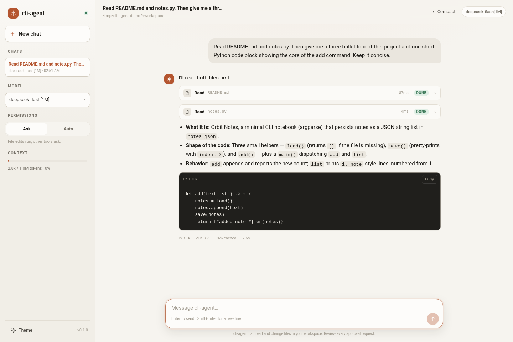

# cli-agent

A small, provider-neutral CLI coding agent.

`cli-agent` is built around one agent loop, explicit tool and permission boundaries,
durable sessions, context compaction, long-term memory, and a modular system prompt.
It is provider-neutral: the Anthropic-compatible adapter works with Anthropic and
compatible endpoints such as DeepSeek, Kimi, MiniMax, and GLM.

## Design

```
user input
  -> context pipeline (repair, summarize when the budget is full)
  -> provider.stream()
  -> text deltas / tool calls
  -> tool executor (validate -> permission -> run)
  -> tool results appended
  -> repeat until the model stops calling tools
```

One `AgentRuntime` owns the transcript, the model, and usage. The CLI only reads input,
renders events, and calls the runtime.

## Install

```bash
uv sync
uv run cli-agent --help
```

## Configure a provider

Providers are explicit; `cli-agent` never guesses from the model name.

```bash
export DEEPSEEK_API_KEY=...
uv run cli-agent --provider deepseek --model deepseek-flash[1M]
```

Or copy [config.example.toml](config.example.toml) to `~/.config/cli-agent/config.toml`:

```toml
default_provider = "deepseek"
default_model = "deepseek-flash[1M]"
permission_mode = "accept-edits"

[providers.deepseek]
kind = "anthropic_compat"
base_url = "https://api.deepseek.com/anthropic"
api_key_env = ["DEEPSEEK_API_KEY"]
default_model = "deepseek-flash[1M]"
context_window = 880000
max_output_tokens = 128000
supports_thinking = true
thinking_by_default = true

[thinking]
# Leave enabled unset to use the provider default (DeepSeek: on).
# enabled = false
budget_tokens = 100000  # must be below max_output_tokens

[memory]
# The agent writes memory through the Remember tool; no background extraction.
enabled = true
```

## Web client

```bash
cli-agent web                    # loopback on :8765, opens the browser
cli-agent web --provider deepseek --no-open
cli-agent web -c                 # resume the latest session
```



[Dark theme](docs/web/chat-dark.png) · [Approval prompt](docs/web/approval.png) ·
[Mobile](docs/web/mobile.png)

The page is served by `src/cli_agent/web/server.py`, a thin HTTP/SSE adapter over the
same `AgentRuntime`:

- streaming text, collapsible reasoning, and tool cards with input/output;
- approval prompts bridged to the browser (deny / allow once / always). High-risk
  deletes only offer a single approval, matching the CLI guard;
- Ask/Auto permission toggle, model switcher, context meter, and a compact action;
- recent chats read from the project's session directory, newest activity first;
  opening one goes through the normal resume path and creates a fresh runtime;
- "New chat" creates a new session instead of clearing the current one;
- cancellation stops the running turn through the runtime, not by killing the server.

Streaming uses server-sent events. Each frame is a JSON object with a `type`:
`turn_start`, `text`, `reasoning`, `tool_started`, `tool_finished`,
`permission_request`, `usage`, `context`, `notice`, `retry`, `error`, `cancelled`,
and `done`.

The server binds to `127.0.0.1` by default and has **no authentication**. It warns on a
non-local host, but you should still put an authenticated proxy in front before
exposing it. The page ships with a strict CSP and makes no external requests.

## Headless output

`cli-agent run` is the one-shot headless mode. Use `run -` to read the prompt
from stdin. `--output-format` selects the output shape:

| Format | stdout |
|---|---|
| `text` (default) | assistant text only |
| `json` | one JSON result object |
| `jsonl` | one JSON object per line, emitted as events arrive |

stdout carries data only; logs and diagnostics go to stderr.

```bash
printf "Summarize this repo" | cli-agent run --output-format jsonl -
cli-agent run --permission-mode bypass --output-format json "Run the tests"
```

JSONL event types:

```text
session_start, text, reasoning, tool_started, tool_finished,
usage, notice, context, error, result
```

`reasoning` is included only with `--thinking`. The final `result` object includes
`session_id`, `provider`, `model`, `resumed`, `stop_reason`, `is_error`,
`is_complete`, `text`, `tool_calls`, `usage`, `notices`, `context_events`, and
`error`.

Exit codes:

```text
0    stop_reason == end_turn
2    agent error, or incomplete turn (max_tokens / max_turns / refusal)
1    config / provider / session error
130  interrupted
```

In headless mode there is no interactive permission asker: use
`--permission-mode bypass` (or allow rules) if the task needs shell commands.

## Usage

```bash
cli-agent                              # interactive REPL
cli-agent -c                           # resume the latest REPL session
cli-agent --resume <session-id>
cli-agent -c --fork                    # fork the latest session into a copy
cli-agent --resume <session-id> --fork
cli-agent --permission-mode default
cli-agent --provider deepseek           # REPL, defaults to deepseek-flash[1M] + thinking
cli-agent --provider deepseek --no-extended-thinking
                                        # disable the provider's thinking default
cli-agent --no-thinking                 # hide model reasoning in the REPL

cli-agent run "fix the failing test"    # one-shot
cli-agent run -                         # one-shot, prompt from stdin
cli-agent run -c "continue"             # one-shot, resume the latest session
cli-agent run --permission-mode bypass "run the tests"
cli-agent run --output-format jsonl "..."  # JSONL events
cli-agent run --thinking "..."           # reasoning on stderr
```

Common options may be placed before or after `run` (for example
`cli-agent --provider deepseek run "..."` and `cli-agent run --provider deepseek
"..."` are equivalent).

On resume, explicit `--provider`/`--model` override the saved session. If you
change the provider without a model, the new provider's default model is used.

`--fork` copies the resumed session (history, usage, checkpoint, spills) under a new
id and continues in the copy; the original stays untouched and may even be open in
another process. The REPL prints the session it was forked from.

`--extended-thinking` is a request capability: it sends the provider's `thinking`
parameter and requires the selected provider/model to declare `supports_thinking`.
Providers may also default it on (`thinking_by_default`); the DeepSeek preset does,
so `cli-agent --provider deepseek` requests thinking without extra flags.
`--thinking/--no-thinking` only controls display, so `--thinking` alone will not make
the model think. Use a reasoning-capable model; for DeepSeek, `deepseek-flash`
(not `deepseek-chat`) produces reasoning.

`run` exits `0` only when the turn ends normally. A refusal, provider error, or
`--max-turns` cutoff exits `2`, and the stop reason is written to stderr. Retries are
announced too (inline in the REPL, on stderr in one-shot mode); if an attempt had already
streamed text, the notice says that the earlier text is stale rather than silently
splicing two partial answers together.

`/cost` reports billed usage (uncached input, output, cache reads and writes), the
estimated size of the last request against the context window, and the prefix cache
hit rate for that request and for the session. Provider `input_tokens` excludes the
cached prefix, so prompt size is input + cache reads + cache writes; the token
estimator and its calibration use that sum. `/compact` warns before rewriting the
prompt prefix, because the next request has to re-read the context.

Built-in tools: `Bash`, `Read`, `Write`, `Edit`, `Glob`, `Grep`, `load_skill`, and
`Remember` when memory is enabled.
`Glob` skips dependency and build directories unless the pattern or `path` names one.
Consecutive read-only calls (`concurrency_safe`) in one turn run in parallel; writes and
shell commands stay ordered barriers, and permission prompts are always serialized.
`/auto [on|off]` toggles full-permission mode and remembers the mode it replaced. The
change is appended to the session, so `-c` restores it (an explicit `--permission-mode`
still wins), and the REPL banner shows the active mode.

Shell commands pass one static guard first: recursive deletes aimed at `/`, `$HOME`, a
parent directory, the current directory, or a system directory always need a fresh
interactive approval — bypass and `/auto` do not skip it, and "always" is never
remembered for them. It is approval UX, not a sandbox: `sh -c`, `xargs`, and scripts are
out of scope, and an explicit `permissions.allow` rule still wins.

Sessions, memory, and session spill files live under
`$XDG_DATA_HOME/cli-agent/projects/<project-id>/`. Project instructions are read from
`AGENTS.md` and `.agents/`; `cli-agent` does not reuse `.claude/` or `CLAUDE.md`.
`@include` paths in project instructions are restricted to the workspace; includes in
the global config `AGENTS.md` are restricted to the config directory.

## Docs

- [01 · 一次流式工具调用：从 SSE 到 ToolResultBlock](docs/learn/01_streaming_tool_call.md)
  —— 模型、API、SSE、SDK、adapter、runtime、ToolExecutor 的完整路径；以及为什么内部
  Block/Delta 不直接使用 SDK 类型。
- [Stability hardening plan](docs/plan/stability-hardening.md)
  —— P0/P1 稳定性工作项、测试与验收标准。
- [Review notes](docs/revision/REVISION_SUGGESTIONS.recovered.md)
  —— 独立审稿与当前修复状态。

## System prompt

The prompt is assembled from ordered modules under `src/cli_agent/context/prompts/`:
identity, workspace, tools, file/shell policies, project instructions, memory, skills,
and compaction. The tool list is generated from the live registry, and modules only
claim capabilities the harness actually implements. Modules marked `cacheable` form the
static prefix; when the provider profile sets `prompt_caching = true` (the `anthropic`
preset does) the adapter emits `cache_control` breakpoints for that prefix and the tool
schemas. Third-party Anthropic-compatible endpoints stay off by default because they may
reject the field.

## Status (v1)

Implemented today:

- one async agent loop with streaming text, normalized tool calls, retries,
  `max_tokens` continuation, and cancellation;
- explicit provider abstraction plus the Anthropic-compatible adapter
  (Anthropic, DeepSeek, Kimi, MiniMax, GLM presets);
- `Bash`, `Read`, `Write`, `Edit`, `Glob`, `Grep`, `load_skill`;
- image input: `Read` returns image blocks for png/jpeg/gif/webp, and presets
  declaring `supports_images` (`anthropic`, `deepseek`) forward them; other profiles
  receive a text placeholder instead;
- ordered tool execution inside the one loop: permission checks stay serialized, and
  consecutive `concurrency_safe` reads run in parallel while writes and shells act as
  barriers;
- opt-in prompt caching: `cache_control` breakpoints for the static prompt prefix and
  tool schemas on profiles with `prompt_caching = true`;
- permission modes, allow/deny rules, workspace boundary, interactive and
  fail-closed non-interactive asks, and `/auto` for full-permission mode;
- append-only JSONL sessions, `-c/--resume`, `--fork` into a copied session, transcript
  repair, context checkpoints;
- append-only history: earlier messages are never rewritten to save tokens, so the
  provider's prefix cache stays valid. Oversized tool output is spilled once, when it
  is produced, and the transcript stores the pointer;
- summarization at 85% of the token budget (plus reactive compaction after a
  context-length error) is the only stage that rewrites history; the checkpoint keeps
  the new prefix stable;
- file-backed memory written only by the agent's `Remember` tool (strict admission
  criteria in the tool description and prompt); records are injected into the newest
  user message, so the cached system prefix stays stable. `/memory [list|forget X]`
  inspects or removes them;
- skills from `~/.config/cli-agent/skills` and `.agents/skills`;
- extended thinking requests for providers that support them (Anthropic and DeepSeek
  presets; opt in another provider with `supports_thinking = true`), with provider
  defaults (`thinking_by_default`), budget validation, and signed-reasoning replay
  after tool calls. The DeepSeek preset defaults to `deepseek-flash[1M]` with thinking
  on;
- streaming reasoning display: on by default in the REPL, off in one-shot mode;
  `--thinking/--no-thinking` overrides it (one-shot mode writes reasoning to stderr);
- REPL (`cli-agent`), one-shot (`cli-agent run`), and
  `/help /clear /compact /model /auto /memory /cost /exit`;
  `/clear` starts a new conversation and resets usage, so `/cost` counts from that point;
- local web client (`cli-agent web`) with streaming chat, browser approval prompts,
  recent-chat switching, Ask/Auto mode, and cancellation over SSE;
- headless `--output-format text|json|jsonl` with a stable result schema, clean
  stdout, stderr diagnostics, and non-zero exit on incomplete turns.


Deliberately deferred: MCP, external hook processes, subagents, teams, worktrees,
cron/background tasks, workflow runtime, goal loop, web tools, LSP, notebook, plan
mode, tool search, OpenAI-compatible adapter, and a public plugin SDK.

Notes: compaction is best-effort. Permission rules are approval UX,
not a sandbox — shell allow rules are skipped for commands containing common
composition operators or launchers, quoted operators are treated conservatively,
and `always` is scoped to the exact command/path/tool. Use an external sandbox for
untrusted work. DeepSeek-compatible endpoints may emit reasoning even without
`--extended-thinking`; the display flag still controls whether it is shown.

## Development

```bash
uv sync --extra dev
uv run pytest
uv run pytest tests/e2e -q   # skipped unless CLI_AGENT_E2E_PROVIDER is set
uv run ruff check src tests
uv run mypy src
```
