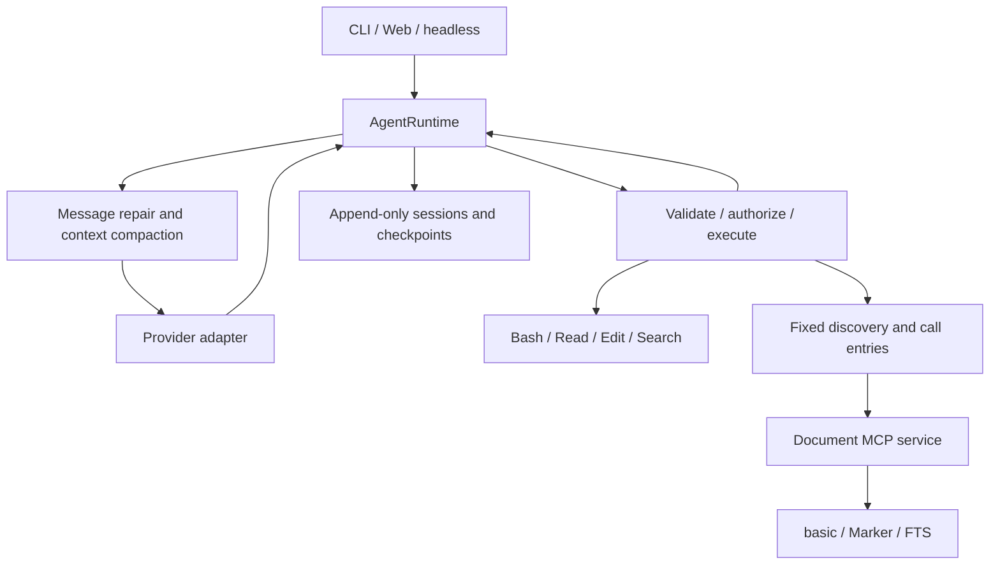

# Architecture

[简体中文](architecture.md) | **English** · [Home](../README.en.md)

One `AgentRuntime` owns the transcript, model, and usage. The CLI, Web, and
one-shot hosts handle input and presentation. `assembly.py` constructs the
concrete providers, tools, stores, and context components.

## Core boundaries

| Module | Responsibility |
|---|---|
| `runtime.py` / `runtime_attempt.py` | Turn loop, one streamed attempt, retries, tool cycles, and completion state |
| `messages.py` / `events.py` | Provider-neutral messages and events |
| `providers/` | Vendor protocols, cache parameters, and normalized usage |
| `tools/` / `permissions/` | JSON Schema validation, permissions, execution, concurrency, and error results |
| `context/` | Instructions and skills, memory, output spills, token estimates, and compaction |
| `session/` | Append-only records, resume, fork, display metadata, and file checkpoints |
| `mcp/` / `deepdocx/` | External tool discovery, stdio calls, library access, and image results |
| `cli/` / `web/` | Terminal rendering, HTTP/SSE, and the browser interface |

Tool failures return `ToolResult(is_error=True)` so the model can adjust its
approach. Authorization follows call order. Consecutive safe reads may run in
parallel, with results returned in the model's original call order.

## DeepDocx mode

Mode and library bindings are session state. Given the same shared settings,
both modes use the same complete system prompt and provider-facing tool
schemas. A short document introduction enters message context with an explicit
host-source marker; detailed guidance is read through tools on demand.

`DiscoverTools` / `CallExternalTool` are fixed entries. Actual external tools
remain in a private catalog. Discovery results enter context as ordinary tool
results, and calls use the actual schema and permissions.

The document service does not run an answer model. It returns location cards,
source text, images, and evidence identifiers. The main agent decides the
sequence of retrieval, reading, visual analysis, and answering. Locators include
source version and rendition so search hits, reads, and previews resolve to the
same evidence.

## Long context and persistence

Session history is appended. Oversized tool output is spilled when created, and
the transcript stores a stable pointer. Compaction establishes a new prefix
through a checkpoint; ordinary turns do not repeatedly rewrite earlier messages.
Saved memory enters message context so preference changes do not alter the
system prefix.

Usage distinguishes uncached input, output, cache reads, and cache writes.
Prompt size includes input and cached portions, and is used for context readouts
and token-estimator calibration.

File checkpoints retain content before Write / Edit and the post-operation
hash. Restoration checks manual changes, backup integrity, and path boundaries.
Shell operations are recorded separately; file checkpoints cannot restore all
their effects.

Persistent state lives in XDG directories. Workspace namespaces currently use a
hash of the absolute working-directory path. Moving a workspace therefore
requires handling its history namespace; see
[troubleshooting](troubleshooting.en.md).
