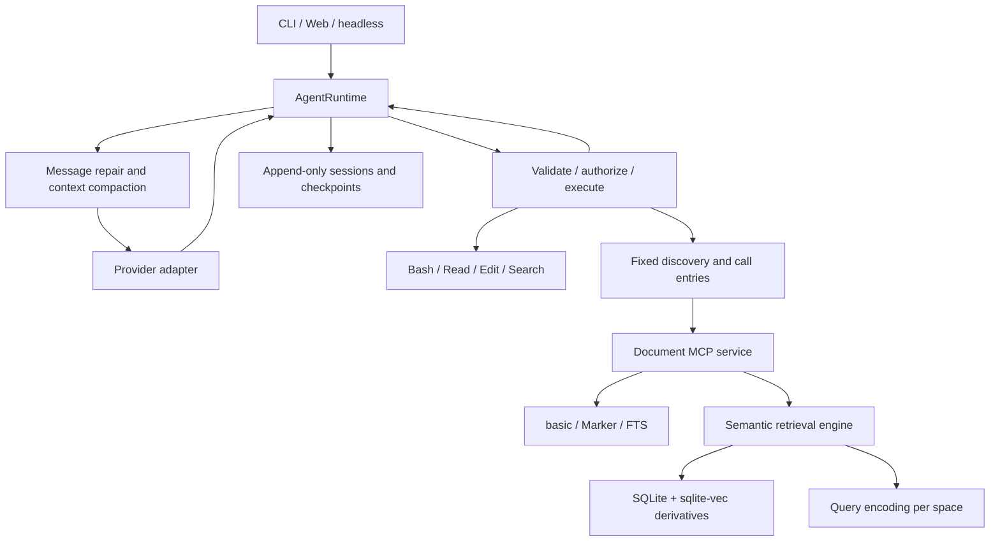
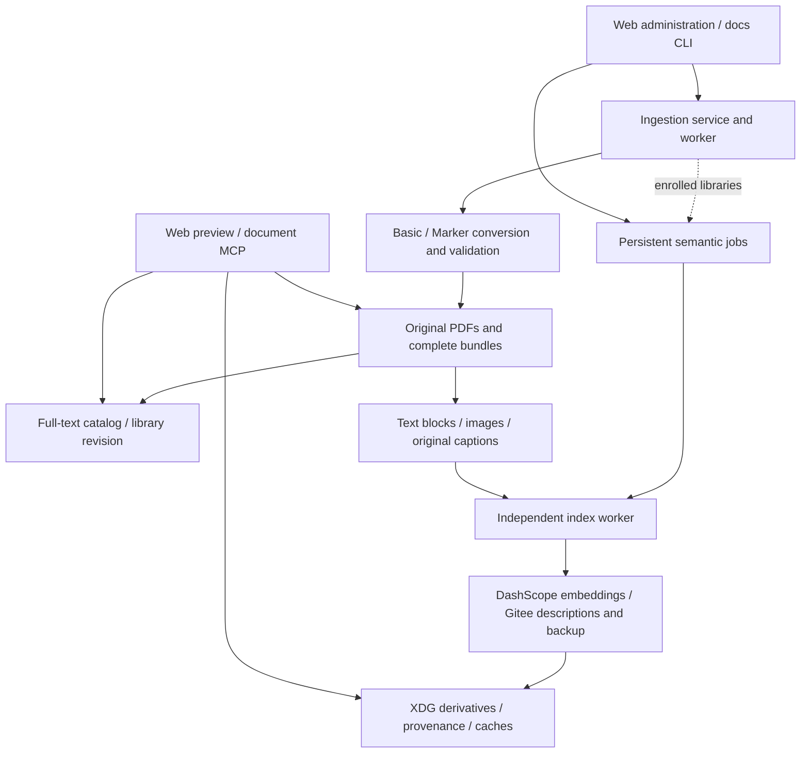

# Architecture

[简体中文](architecture.md) | **English** · [Home](../README.en.md)

One `AgentRuntime` owns the transcript, model, and usage. The CLI, Web, and
one-shot hosts handle input and presentation. `assembly.py` constructs the
concrete providers, tools, stores, and context components.

## Core boundaries

| Module | Responsibility |
|---|---|
| `runtime.py` / `runtime_attempt.py` | The only agent turn loop, one streamed attempt, retries, tool cycles, and completion state |
| `config.py` / `assembly.py` | Configuration, runtime dependency wiring, and document MCP settings/credential handoff |
| `messages.py` / `events.py` | Provider-neutral messages and events |
| `providers/` | Vendor protocols, cache parameters, and normalized usage |
| `tools/` / `permissions/` | JSON Schema validation, permissions, execution, concurrency, and error results |
| `context/` | Instructions and skills, memory, output spills, token estimates, and compaction |
| `session/` | Append-only records, resume, fork, display metadata, and file checkpoints |
| `mcp/` | External discovery, stdio connections, schemas, and result adaptation |
| `deepdocx/library.py` / `profile.py` / `server.py` | Document scopes, mode context, heterogeneous bundle reading, and read-only MCP |
| `deepdocx/ingest/` | PDF upload, Basic/Marker conversion, atomic publication, and full-text catalog updates |
| `deepdocx/semantic/` | Semantic samples, inference clients, vector storage, incremental jobs, and read-only retrieval |
| `cli/` / `web/` | Terminal rendering, HTTP/SSE, and the browser interface |

Tool failures return `ToolResult(is_error=True)` so the model can adjust its
approach. Authorization follows call order. Consecutive safe reads may run in
parallel, with results returned in the model's original call order.

## DeepDocx mode

Mode and library bindings are session state. Given the same shared settings,
both modes use the same complete system prompt and provider-facing tool
schemas. A short document introduction enters message context with an explicit
host-source marker; detailed guidance is read through tools on demand.

`DiscoverTools` / `CallExternalTool` are fixed entries. Actual external tools
remain in a private catalog. Discovery results enter context as ordinary tool
results, and calls use the actual schema and permissions.

The document service does not run an answer model. It returns location cards,
source text, images, and evidence identifiers. The main agent decides the
sequence of retrieval, reading, visual analysis, and answering. Locators include
source version and rendition so search hits, reads, and previews resolve to the
same evidence.

Semantic indexes add `doc_index_status` and `doc_semantic_search` through the
same fixed MCP entries and on-demand disclosure. They do not replace the agent
loop or introduce a retrieval planner. The main agent can use keywords or Read
directly, or retrieve semantic candidates and inspect their sources. Missing or
stale indexes return explicit guidance.

The unified `doc_semantic_search` interface accepts text, `image_ref`, and
`target=auto/text/image` to select retrieval channels. Results default to at most
five source cards with coverage/provenance, without attaching paragraphs or
images. Bootstrap discovery includes semantic capabilities; status lookup is
optional rather than a mandatory preflight for every search.

`session/attachments.py` owns content-hash image references. `assembly.py` wires
its message-context callback into `ContextPipeline` and binds document MCP to the
current session root. Request views contain `attachment:...` references while
original messages and append-only history retain their contents; system prompts
and fixed tool schemas are unaffected. Files copy with sessions, so forks do not
depend on source-session paths. Resolution checks content hashes and the session
boundary. Web renders coverage badges and source cards without implicit retrieval
before a question reaches the agent.

## Long context and persistence

Session history is appended. Oversized tool output is spilled when created, and
the transcript stores a stable pointer. Compaction establishes a new prefix
through a checkpoint; ordinary turns do not repeatedly rewrite earlier messages.
Saved memory enters message context so preference changes do not alter the
system prefix.

Usage distinguishes uncached input, output, cache reads, and cache writes.
Prompt size includes input and cached portions, and is used for context readouts
and token-estimator calibration.

File checkpoints retain content before Write / Edit and the post-operation
hash. Restoration checks manual changes, backup integrity, and path boundaries.
Shell operations are recorded separately; file checkpoints cannot restore all
their effects.

Persistent state lives in XDG directories. Workspace namespaces currently use a
hash of the absolute working-directory path. Moving a workspace therefore
requires handling its history namespace; see
[troubleshooting](troubleshooting.en.md).

## Document writers and derived indexes

Reading evidence, publishing source artifacts, and building derivatives have
separate boundaries:

Ingestion runs fixed converters and catalog updates without a conversational
model. Optional semantic jobs call embedding and visual description services as
independent system tasks. They create no agent turns, edit no transcripts, and
expose no `doc_build`, rebuild, or caption-batch write tools. Ingestion outcomes
and semantic jobs are recorded separately; inference failure does not roll back
published bundles.

Ingestion and semantic indexing have separate queues and workers. Semantic
workers serialize across libraries. Manual sync persists a job and credential-free
configuration before starting a worker; records remain available after restart.
Cancellation keeps committed documents and caches. Dead workers are detected;
another sync retries using cached progress. Ingestion during an active sync
requests a follow-up incremental pass.

### Source evidence and derivatives

| Storage | Contents and writer |
|---|---|
| Library bundles and original PDFs | Source evidence published by ingestion; retrieval, captions, and vector construction do not modify it |
| Library `catalog.sqlite` and `.dcx-revision` | Basic full-text catalog and reader refresh notification maintained by ingestion |
| `$XDG_DATA_HOME/dcx/semantic/<library-id>/index.sqlite` | Vectors, document generations, fingerprints, caption provenance, caches, preferences, and job state |
| Adjacent `jobs/<job-id>/` | Credential-free configuration and worker logs, separate from conversation records |

Records retain library, document, version, rendition, unit/asset, and original
locator identities. Each document generation commits atomically. Queries verify
content fingerprints, configuration generation, and session scope, excluding
deleted, changed, or out-of-scope sources. Unchanged documents require no
inference; changed configurations reuse applicable caches. Externally copied
bundles require manual synchronization; there is no filesystem watcher. Library
IDs follow normalized root paths, so moving a library requires syncing its new
identity.

### Four families and two vector spaces

Text blocks, images, captions, and native image–text combinations are four
functional families. Original captions and generated descriptions remain
distinct, giving six representations: `text_block`, `image`,
`caption_original`, `caption_generated`, `image_caption_original`, and
`image_caption_generated`. Marker paragraphs and figure crops are preferred;
Basic lines are grouped by layout, with page images explicitly labeled as pages.

DashScope `qwen3-vl-embedding` defaults to 2560 dimensions for both standalone
and native image–text encoding. Gitee provides descriptions and an explicit
`Qwen3-VL-Embedding-8B` backup configuration. Independent/joint channels remain
separate, with profile isolation when a service or dimension changes. Queries use sqlite-vec's
exact cosine distance within each space, then combined by RRF. Final `score` is
a rank score; `similarities` retains within-space values. Equal dimensions do
not permit cross-space cosine comparisons or vector averaging.

Generated descriptions retain the model, revision, timestamp, input hash, and
supporting source context. They are not quotations from the paper. Retrieval
returns bounded candidates and original source locators; actual image inspection
still needs `doc_view`/Read and an image-capable conversational model. The current
backend is local SQLite exact search; ANN and large-scale performance guarantees
are outside its present scope. See [multimodal indexes](multimodal-index.en.md)
for configuration and synchronization, and [ingestion](deepdocx-ingest.en.md)
for conversion and publication.
