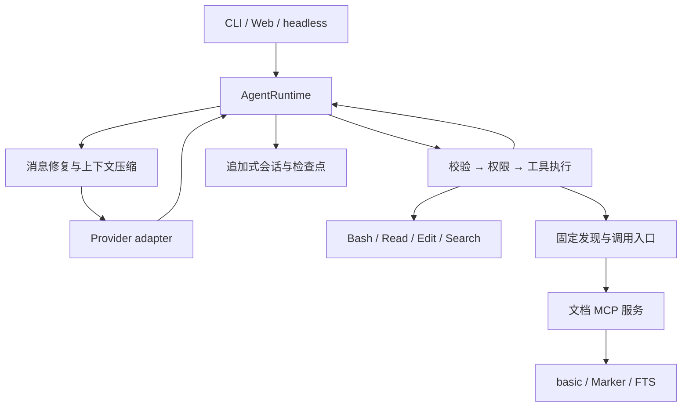
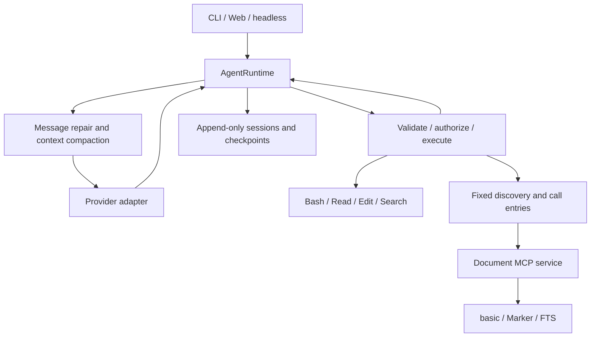

<!-- Generated language panels. Edit this file's default-open language, then run python scripts/sync_doc_languages.py. -->

简体中文

<!-- doc-language:zh-CN:start -->
# 架构说明

[首页](../README.md)

DeepCodocx 以一个 `AgentRuntime` 管理消息、模型和用量。CLI、Web 和一次性执行只负责
输入与展示；具体 provider、工具、存储和上下文组件由 `assembly.py` 装配。

## 核心边界

| 模块 | 职责 |
|---|---|
| `runtime.py` / `runtime_attempt.py` | 回合循环、单次流式请求、重试、工具循环和完成状态 |
| `messages.py` / `events.py` | 与 provider 无关的消息和事件 |
| `providers/` | 厂商协议、缓存参数和用量归一化 |
| `tools/` / `permissions/` | JSON Schema、权限、执行、并发与错误结果 |
| `context/` | 指令与 skills、记忆、输出落盘、token 估算与压缩 |
| `session/` | 追加式记录、恢复、fork、展示元数据和文件检查点 |
| `mcp/` / `deepdocx/` | 外部能力发现、stdio 调用、文档库访问和图像返回 |
| `cli/` / `web/` | 终端渲染、HTTP/SSE 和浏览器界面 |

工具失败作为 `ToolResult(is_error=True)` 返回，模型能够据此调整做法。授权按调用顺序
进行，连续安全读取可以并行执行，返回结果保留模型的调用顺序。

## DeepDocx 模式

模式与文档库属于会话状态。在相同公共配置下，两种模式共用完整 system 和
provider 工具 schema。文档启动资料进入带宿主来源标记的消息上下文，详细操作说明
通过工具按需取得。

`DiscoverTools` / `CallExternalTool` 始终是固定入口。真实外部工具留在私有目录，
发现结果作为普通工具返回进入上下文，调用前按实际 schema 与权限执行。

文档服务不运行回答模型：它返回定位卡、原文、图像和明确的来源。检索、阅读、视觉分析
与回答的顺序仍由主 Agent 决定。异构产物的定位符包含 source version 与 rendition，
保持检索结果、回读和前端预览指向同一份证据。

## 长上下文与持久化

会话历史追加保存，超长工具输出在生成时落盘，历史中保存稳定指针。
压缩通过 checkpoint 建立新的前缀；平时不反复改写较早消息。
保存的记忆注入消息上下文，避免用户偏好变化引起 system 前缀变化。

用量区分未缓存输入、输出、缓存读取与缓存写入。请求大小按输入与缓存部分之和估算，
用于上下文读数和 token 估算校准。

文件检查点保存 Write / Edit 前的内容及操作后的 hash；恢复时检查手工修改、备份完整性
和路径边界。Shell 操作另行记录，不能由文件检查点还原其全部效果。

持久数据位于 XDG 目录。项目空间目前由工作目录绝对路径的 hash 区分；迁移工作目录时
需处理历史命名空间，见[常见问题](troubleshooting.md)。
<!-- doc-language:zh-CN:end -->

English

<!-- doc-language:en:start -->
# Architecture

[Home](../README.en.md)

One `AgentRuntime` owns the transcript, model, and usage. The CLI, Web, and
one-shot hosts handle input and presentation. `assembly.py` constructs the
concrete providers, tools, stores, and context components.

## Core boundaries

| Module | Responsibility |
|---|---|
| `runtime.py` / `runtime_attempt.py` | Turn loop, one streamed attempt, retries, tool cycles, and completion state |
| `messages.py` / `events.py` | Provider-neutral messages and events |
| `providers/` | Vendor protocols, cache parameters, and normalized usage |
| `tools/` / `permissions/` | JSON Schema validation, permissions, execution, concurrency, and error results |
| `context/` | Instructions and skills, memory, output spills, token estimates, and compaction |
| `session/` | Append-only records, resume, fork, display metadata, and file checkpoints |
| `mcp/` / `deepdocx/` | External tool discovery, stdio calls, library access, and image results |
| `cli/` / `web/` | Terminal rendering, HTTP/SSE, and the browser interface |

Tool failures return `ToolResult(is_error=True)` so the model can adjust its
approach. Authorization follows call order. Consecutive safe reads may run in
parallel, with results returned in the model's original call order.

## DeepDocx mode

Mode and library bindings are session state. Given the same shared settings,
both modes use the same complete system prompt and provider-facing tool
schemas. A short document introduction enters message context with an explicit
host-source marker; detailed guidance is read through tools on demand.

`DiscoverTools` / `CallExternalTool` are fixed entries. Actual external tools
remain in a private catalog. Discovery results enter context as ordinary tool
results, and calls use the actual schema and permissions.

The document service does not run an answer model. It returns location cards,
source text, images, and evidence identifiers. The main agent decides the
sequence of retrieval, reading, visual analysis, and answering. Locators include
source version and rendition so search hits, reads, and previews resolve to the
same evidence.

## Long context and persistence

Session history is appended. Oversized tool output is spilled when created, and
the transcript stores a stable pointer. Compaction establishes a new prefix
through a checkpoint; ordinary turns do not repeatedly rewrite earlier messages.
Saved memory enters message context so preference changes do not alter the
system prefix.

Usage distinguishes uncached input, output, cache reads, and cache writes.
Prompt size includes input and cached portions, and is used for context readouts
and token-estimator calibration.

File checkpoints retain content before Write / Edit and the post-operation
hash. Restoration checks manual changes, backup integrity, and path boundaries.
Shell operations are recorded separately; file checkpoints cannot restore all
their effects.

Persistent state lives in XDG directories. Workspace namespaces currently use a
hash of the absolute working-directory path. Moving a workspace therefore
requires handling its history namespace; see
[troubleshooting](troubleshooting.en.md).
<!-- doc-language:en:end -->

