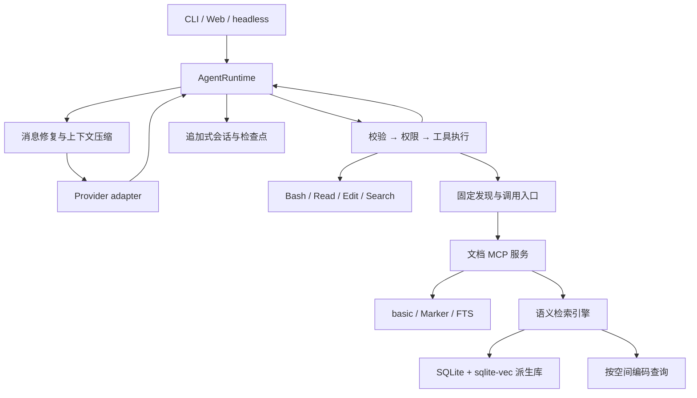
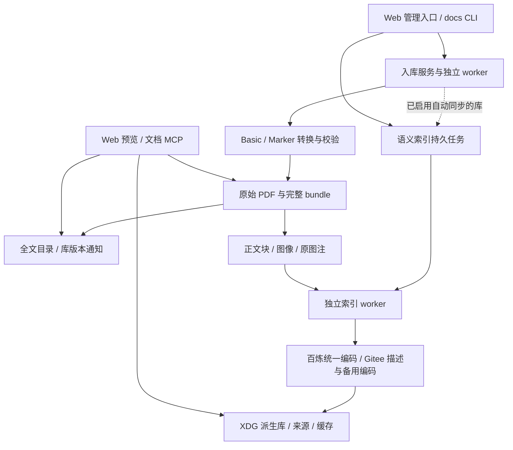

# 架构说明

**简体中文** | [English](architecture.en.md) · [首页](../README.md)

DeepCodocx 以一个 `AgentRuntime` 管理消息、模型和用量。CLI、Web 和一次性执行只负责
输入与展示；具体 provider、工具、存储和上下文组件由 `assembly.py` 装配。

## 核心边界

| 模块 | 职责 |
|---|---|
| `runtime.py` / `runtime_attempt.py` | 唯一 Agent 回合循环、单次流式请求、重试、工具循环和完成状态 |
| `config.py` / `assembly.py` | 配置解析、运行时依赖装配、文档 MCP 的设置与凭证传递 |
| `messages.py` / `events.py` | 与 provider 无关的消息和事件 |
| `providers/` | 厂商协议、缓存参数和用量归一化 |
| `tools/` / `permissions/` | JSON Schema、权限、执行、并发与错误结果 |
| `context/` | 指令与 skills、记忆、输出落盘、token 估算与压缩 |
| `session/` | 追加式记录、恢复、fork、展示元数据和文件检查点 |
| `mcp/` | 外部能力发现、stdio 连接、schema 与结果适配 |
| `deepdocx/library.py` / `profile.py` / `server.py` | 文档范围、模式上下文、异构 bundle 读取和只读 MCP |
| `deepdocx/ingest/` | PDF 上传、Basic／Marker 转换、原子发布与全文目录更新 |
| `deepdocx/semantic/` | 语义样本、外部推理、向量存储、增量任务和只读检索 |
| `cli/` / `web/` | 终端渲染、HTTP/SSE 和浏览器界面 |

工具失败作为 `ToolResult(is_error=True)` 返回，模型能够据此调整做法。授权按调用顺序
进行，连续安全读取可以并行执行，返回结果保留模型的调用顺序。

## DeepDocx 模式

模式与文档库属于会话状态。在相同公共配置下，两种模式共用完整 system 和
provider 工具 schema。文档启动资料进入带宿主来源标记的消息上下文，详细操作说明
通过工具按需取得。

`DiscoverTools` / `CallExternalTool` 始终是固定入口。真实外部工具留在私有目录，
发现结果作为普通工具返回进入上下文，调用前按实际 schema 与权限执行。

文档服务不运行回答模型：它返回定位卡、原文、图像和明确的来源。检索、阅读、视觉分析
与回答的顺序仍由主 Agent 决定。异构产物的定位符包含 source version 与 rendition，
保持检索结果、回读和前端预览指向同一份证据。

语义索引增加的是按需披露的 `doc_index_status` 与 `doc_semantic_search`，仍经固定
MCP 入口调用。它不会替换主循环或建立检索规划器。主 Agent 可以先关键词查找、直接
Read，也可以使用语义候选后回读证据；缺失／过期索引会明确返回提示。

`doc_semantic_search` 用统一的文字、`image_ref` 与 `target=auto/text/image` 接口选择
检索通道，默认返回最多 5 条来源卡片，附实际覆盖与生成来源，不自动附原文或图片。
启动引导的工具发现包含语义能力；状态查询按需使用，不要求每次检索先走状态请求。

`session/attachments.py` 管理当前会话的内容哈希图像引用，`assembly.py` 将其接到
`ContextPipeline` 的消息上下文回调，并为文档 MCP 绑定当前会话根目录。
消息视图包含 `attachment:...`，原始消息和追加式历史保持原样；system 和固定工具
schema 不受附件影响。引用文件随会话复制，fork 不依赖源会话路径；解析时核对哈希与
当前会话边界。Web 只渲染覆盖徽标和证据卡片，不在提问前隐式运行检索。

## 长上下文与持久化

会话历史追加保存，超长工具输出在生成时落盘，历史中保存稳定指针。
压缩通过 checkpoint 建立新的前缀；平时不反复改写较早消息。
保存的记忆注入消息上下文，避免用户偏好变化引起 system 前缀变化。

用量区分未缓存输入、输出、缓存读取与缓存写入。请求大小按输入与缓存部分之和估算，
用于上下文读数和 token 估算校准。

文件检查点保存 Write / Edit 前的内容及操作后的 hash；恢复时检查手工修改、备份完整性
和路径边界。Shell 操作另行记录，不能由文件检查点还原其全部效果。

持久数据位于 XDG 目录。项目空间目前由工作目录绝对路径的 hash 区分；迁移工作目录时
需处理历史命名空间，见[常见问题](troubleshooting.md)。

## 文档写侧与派生索引

文档读取、源产物写入、派生索引构建有各自的边界：

入库阶段只运行固定转换器和全文目录更新，不依赖对话模型。可选的语义阶段会调用
embedding 与视觉描述服务，但由独立系统任务执行，不产生 Agent 回合、不改写历史，
也不提供 `doc_build`、索引重建或 caption 批处理等模型写工具。入库结果与语义任务
分别记录；推理服务失败不会撤销已经发布的 bundle。

两类持久任务有独立队列和 worker，语义队列跨库串行处理。手动同步先记录任务和
无密钥配置快照，再启动 worker；记录在重启后仍可读取。取消保留已提交文档和缓存，
异常退出会被识别并可通过再次同步重试。入库发生于同步期间时，合并一次后续增量扫描。

### 源证据与派生数据

| 存储 | 内容与写入者 |
|---|---|
| 文档库中的 bundle、原始 PDF | 入库服务发布的源证据；检索、caption 和向量构建不修改它 |
| 文档库中的 `catalog.sqlite`、`.dcx-revision` | 入库服务维护的 Basic 全文目录和读侧刷新通知 |
| `$XDG_DATA_HOME/dcx/semantic/<library-id>/index.sqlite` | 向量、文档代次、输入指纹、caption 来源、缓存、偏好与任务状态 |
| 同目录 `jobs/<job-id>/` | 无密钥配置快照、后台日志；不属于会话对话 |

语义记录关联 library、doc、version、rendition、unit／asset 和原始 locator。单文档代次
以 SQLite 事务提交；查询核对内容指纹、配置代次与会话范围，过滤删除、变更或范围外的
来源。内容未变时同步跳过推理，配置变更时复用仍适用的缓存。外部复制的 bundle 需
手动同步；当前没有文件系统监听。库 ID 按规范化根路径确定，移动文档库需要同步新身份。

### 四类表征与两个向量空间

正文块、图像自身、caption、原生图文联合是四个功能类别。原图注与生成描述分开保存，
实际对应六个 representation：`text_block`、`image`、`caption_original`、
`caption_generated`、`image_caption_original`、`image_caption_generated`。
Marker 优先提供段落和图表裁图，Basic 文本行按版面组块，页面图标记为 page。

百炼 `qwen3-vl-embedding` 默认以 2560 维编码独立文本／图像及原生图文输入；
Gitee 生成描述，并保留 `Qwen3-VL-Embedding-8B` 独立编码的显式备用配置。
独立与联合通道分别查询，切换服务或维度后按 profile 隔离旧代结果。各通道使用
sqlite-vec 的 cosine 距离做精确检索，再通过 RRF 合并排名。最终 `score` 是排名分数，
`similarities` 保留空间内相似度；维度相同也不能跨空间比较或平均向量。

生成描述记录模型、版本、时间、输入哈希和辅助正文来源，不能作为论文原文引用。
检索返回有界候选与可回读的原始来源；实际看图仍需 `doc_view`／Read 和支持图片的
对话模型。当前后端是本地 SQLite 精确检索，尚未提供 ANN 或大规模性能保证。
配置、接口与同步矩阵见[多模态索引](multimodal-index.md)，转换发布见[文档入库](deepdocx-ingest.md)。
