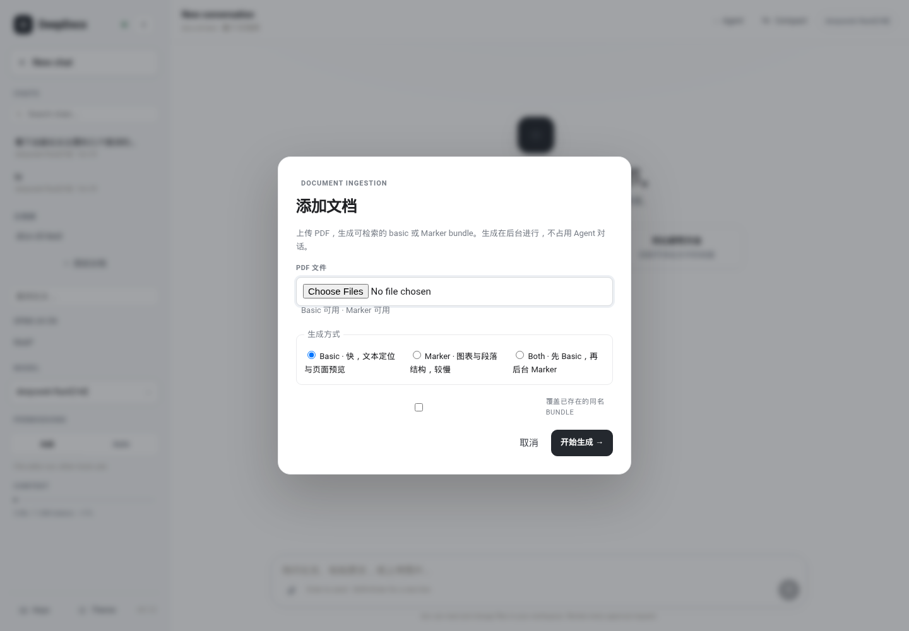

# DeepDocx document ingestion

[简体中文](deepdocx-ingest.md) | **English** · [Home](../README.en.md)

Add PDFs to a connected library, then search the original text and inspect its
pages and figures. **Upload, conversion, publication, and indexing are system
jobs.** They do not call a conversational model, enter Agent Runtime, or appear
as model tools such as `doc_build`.

## Add documents in the Web interface

1. Enter DeepDocx and click **添加文档** (Add documents). Confirm the target library.
2. Select or drop PDFs. Remove files or add more from the file list; the dialog
   shows the current file count and size limits.
3. Choose an available conversion mode. Unconfigured modes are disabled. If the
   environment check fails, fix the connection and click **重新检查** (Check again).
4. Start conversion and inspect the outcome for each file and rendition.

Closing the dialog or choosing **后台运行** (Run in background) keeps the job
running. Reopen it to see progress; after a browser reload, active jobs for the
current library can also be recovered. **停止任务** (Stop task) cancels unfinished
work while keeping complete renditions already published. Reloading during an
upload cannot recover the browser's file stream: stop that job and select the
files again.

Chat and document navigation scroll independently of the Model, Permissions,
and Context controls at the bottom of the sidebar.



[Mobile example](web/deepdocx-ingest-mobile.png) · [Dark theme](web/deepdocx-ingest-dark.png) · [Sidebar with a long library](web/deepdocx-sidebar.png)

## Conversion modes and existing files

| Mode | Output | Requirements and behavior |
|---|---|---|
| Basic | `v1/basic`, `dda.bundle/1` | Poppler; line text, pages, bounding boxes, and page previews at 72 DPI by default; faster |
| Marker | `v1/marker`, `dda.bundle/3` | A separate Marker environment and page rendering; paragraphs, figures, tables, captions, and equations; slower |
| Both | Basic, then Marker | Both sets of dependencies must be ready; Basic can be read after publication and indexing while Marker continues |

All dependencies for the selected mode are checked. Starting is disabled until
an environment check succeeds and valid files are selected. The server validates
independently. Defaults are 200 MiB per file and 50 files per job.

Document IDs follow the existing pipeline and derive from normalized filenames.
Identical content in one batch is deduplicated. Different PDFs with the same
filename in a batch need distinct names. Existing selected renditions are skipped
by default. **替换已有产物** (Replace existing output), or CLI `--force`, rebuilds
selected renditions of the **same PDF**, leaving other rendition types intact.
If the source PDF has changed, rename it before adding it to avoid associating
Basic and Marker with different sources under one document ID.

Outcomes are recorded separately for each rendition. A successful Basic output
with a failed Marker output, or the reverse, is reported as **partial**. Index
update failures also prevent a success result. Published documents remain
readable through lexical scanning when indexing is incomplete.

Locators preserve the version and rendition:

```text
doc:paper_xxx@v1/basic/unit:c_...
doc:paper_xxx@v1/marker-json-v1/unit:u_...
```

## Command line

Document administration runs independently of the agent and needs no provider
or API key:

```bash
# Use data/ or an existing paper-bundles/ root. Create an empty root first.
mkdir -p /path/to/paper-bundles
dcx docs ingest --library /path/to/paper-bundles --mode basic paper.pdf
dcx docs ingest --library /path/to/paper-bundles --mode both paper1.pdf paper2.pdf
dcx docs ingest --library /path/to/paper-bundles --mode basic --force paper.pdf

dcx docs jobs
dcx docs cancel JOB_ID
dcx docs list --library /path/to/paper-bundles
```

`ingest` waits for completion and prints JSON. Exit code 0 means full success;
partial completion, failure, and cancellation return 1. Use `--config` to select
ingestion settings. Interrupting the CLI requests cancellation.

## The writing and reading boundary

```mermaid
flowchart LR
    U[Web upload / docs CLI] --> S[System ingestion service]
    S --> J[Persistent jobs]
    J --> W[Independent worker]
    W --> B[Basic / Marker converter]
    B --> V[Validate and publish]
    V --> L[Bundles and source PDFs]
    L --> I[Incremental FTS and library revision]
    I --> R[Web / read-only document MCP]
    R --> A[Existing agent loop]
```



The agent reads outputs and cannot start ingestion through document MCP tools.
Progress does not change the transcript or trigger model turns. After publication,
Web readers and existing MCP processes refresh their caches on their next read.
A session's document scope remains in force; to include a new document outside
that scope, adjust it and start a new document session.

## Storage and lifecycle

```text
<library>/
  sources/<doc_id>.pdf
  paper-bundles/
    <doc_id>/v1/basic/...
    <doc_id>/v1/marker/...
    catalog.sqlite
    .dcx-revision
```

If the selected root is `paper-bundles/`, `sources/` is its sibling. Each bundle
also retains `source/original.pdf`. Browser uploads are streams, never server
paths supplied by the browser.

Jobs and temporary uploads live under
`$XDG_DATA_HOME/dcx/ingest/jobs/<job-id>/`. Job updates use file locks and atomic
writes. Records survive service restarts; unexpectedly stopped workers are
reported as failed. Cancellation uses persistent state rather than sending a
signal to a potentially recycled PID.

One worker runs at a time in the shared queue to bound converter resource use.
Uploads and agent conversations can continue. Bundles are built in staging on
the library's filesystem and validated before publication, including page images
and Marker checksums. Failed replacements roll back. If rollback itself encounters
an I/O failure, original files remain in `.dcx-recovery/` and the job reports the
recovery location. Incomplete bundles are not published for readers.

Basic indexing updates only affected documents. The initial index scans all Basic
outputs; later jobs update a snapshot and atomically replace `catalog.sqlite`,
keeping the old index on failure. Unindexed new documents fall back to lexical
scanning. Successful, partial, and cancelled jobs clean up temporary uploads;
failed jobs retain inputs and worker logs.

## Configuration

```toml
[deepdocx.ingest]
basic_dpi = 72
max_upload_mb = 200
max_files = 50
marker_command = "/path/to/marker-env/bin/marker_single"
marker_timeout = 1800
```

Basic requires `pdftotext` and `pdftoppm`, available in Ubuntu / WSL through the
`poppler-utils` system package. Marker needs its own executable environment;
page previews and crops also need `pdftoppm` and the project's Pillow dependency.
`marker_command` supports a local command with arguments. Quote executable paths
containing spaces. Readiness checks do not download models or guarantee Marker
weights and GPU readiness; actual converter errors appear in the job. Upload
requests never install Marker or call a conversational model.

Only PDFs are accepted. Optional [multimodal indexing](multimodal-index.en.md)
and generated descriptions run as a separate system job after publication for
libraries enrolled in automatic synchronization.
Basic does not perform OCR; scanned PDFs without extractable text retain page
previews and receive the `NO_TEXT` quality flag. For reading workflows, see the
[DeepDocx guide](deepdocx.en.md).
