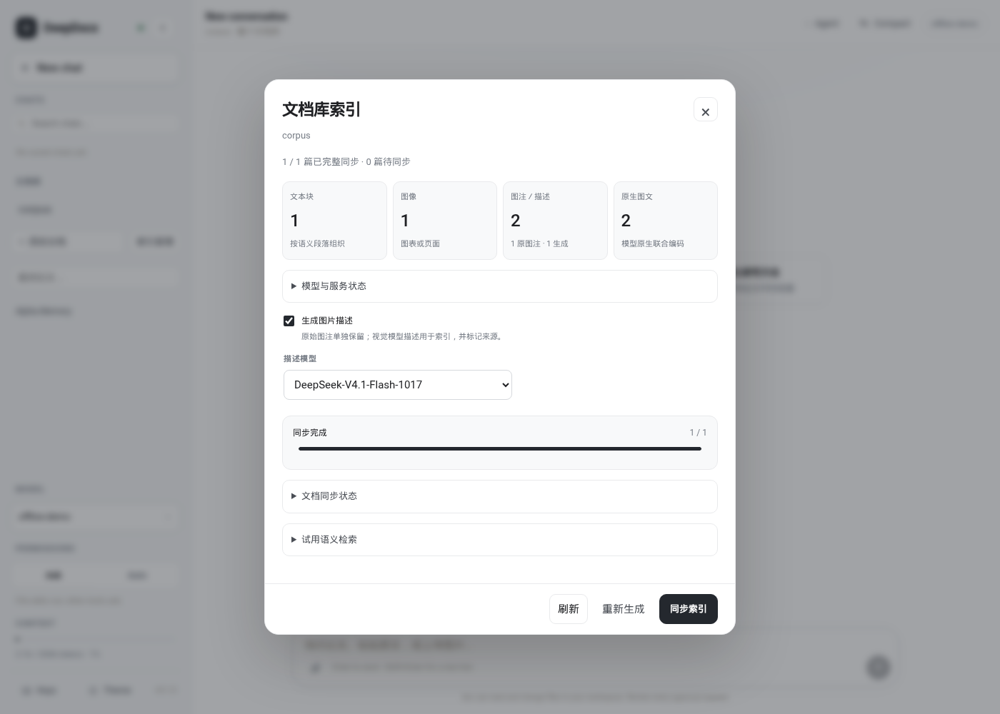

# 多模态索引与语义定位

**简体中文** | [English](multimodal-index.en.md) · [首页](../README.md)

DeepDocx 支持正文语义块、图像、原图注／生成描述、原生图文联合四类向量索引。
它们用于定位文档证据：检索返回片段、页码和原始 locator，随后由同一个 Agent 自主
阅读原文、看图和回答。关键词检索、Bash、Read 与现有 Agent loop 继续可用。

## 模型与向量空间

| 能力 | 默认服务与模型 | 数据表示 |
|---|---|---|
| 正文块、图像、原图注、生成描述的向量 | 阿里云百炼 `qwen3-vl-embedding`，`enable_fusion=false` | 独立编码，默认 2560 维 |
| 图像＋原图注、图像＋生成描述 | 阿里云百炼 `qwen3-vl-embedding`，`enable_fusion=true` | 原生联合编码，默认 2560 维 |
| 生成图片描述 | Gitee AI `qwen3.8-flash` 或 `DeepSeek-V4.1-Flash-1017` | 文字与生成来源；随后用百炼编码 |
| 独立编码备用方案 | Gitee AI `Qwen3-VL-Embedding-8B`，需显式切换配置 | 独立的 Gitee 空间，可配置为 1024 维 |

百炼服务默认维度与项目默认值均为 **2560**，也支持 2048、1536、1024、768、512、256。
项目会明确发送维度和 `enable_fusion`，独立编码每批最多 10 个条目，联合编码将图片
和对应 caption 作为一次输入。查询文字、图片、图文分别按对应方式编码。

默认全部向量由同一百炼模型服务生成。实现仍区分独立和联合查询通道，并用 RRF 合并
候选排名；`score` 为排序分数，`similarities` 保留通道内 cosine。不会用平均向量替代
原生联合编码。切换 Gitee 或其它联合部署时按配置 profile 隔离结果，需同步所选文档，
不会因主服务失败就自动把另一模型的向量写进已有索引。

Gitee 备用网关支持独立文本／图像编码，不支持同一样本原生图文融合；联合服务可继续
使用百炼。相同维度也不意味着不同服务共用向量空间。

### 四类索引对应哪些记录

“四类”是界面按用途分组；原图注与生成描述独立保存，因此数据库与工具过滤条件有
六个 `representation` 值，并非四套互不关联的数据库：

| 界面类别 | representation | 输入与来源 |
|---|---|---|
| 正文块 | `text_block` | 标题、章节和块级正文；保留全部源单元定位符 |
| 图像 | `image` | 图表裁图或明确标记的页面图 |
| 图注／描述 | `caption_original` | 从 bundle 提取的原始图注 |
| 图注／描述 | `caption_generated` | 视觉模型生成描述，带独立生成来源 |
| 图文联合 | `image_caption_original` | 图像与原图注作为一个原生联合输入 |
| 图文联合 | `image_caption_generated` | 图像与生成描述作为一个原生联合输入 |

默认前四项由百炼独立编码，后两项由百炼原生联合编码，同库保存于一个 SQLite 派生数据库。
没有原图注时不会伪造原图注记录；关闭描述生成时也不会创建生成描述及其联合表征。
已有 Basic 的页面图可以建库，Marker 后续补充后重新同步即可更新样本。

## 开始使用

在启动 dcx 的终端设置服务密钥环境变量：

```bash
export GITEE_API_KEY="your-gitee-key"
export DASHSCOPE_API_KEY="your-dashscope-key"
uv sync
uv run dcx web --provider deepseek
```

密钥只从服务端环境读取，不进入浏览器、任务 JSON、bundle 或 Agent 提示词。
更新 shell 配置后，重启 Web 进程使其继承环境。默认百炼地址属于北京地域；其它地域
需要配置与 API key 对应的 endpoint。

进入 DeepDocx，点击文档库旁的 **索引管理**：

1. 查看完整／部分同步文档数和四类表征数量。
2. 选择是否生成图片描述，以及使用的描述模型。
3. 默认使用 **选择论文**：按标题搜索并勾选一篇或多篇，再点击 **同步索引**。需要批量处理时显式选择 **整个文档库**。首次手动同步同时为当前库记住新文档自动同步偏好。
4. 任务在后台运行，可关闭面板，稍后重新打开；重启服务后仍可查看持久任务记录。
5. 在 **试用语义检索** 中输入文字、上传图片，或同时提供两者。点击来源打开已有证据面板。



[暗色主题](web/deepdocx-index-dark.png) · [移动端](web/deepdocx-index-mobile.png)

**重新生成** 会跳过推理缓存，重新请求所选范围的 embedding 与所选 caption。
普通同步会复用内容不变的结果。外部服务可能计费，首次全库构建及重新生成的请求数量
取决于文本块和图像数量；页面图片按 page 标记，不会冒充提取出的 figure。

索引管理支持按论文构建，工具栏会明确显示本次篇数；未选择论文时不允许开始。
单篇同步／重新生成只更新选中文档，不删除其它论文已完成的向量；试查和 Agent 检索
仍受当前会话文档范围约束。
重新打开面板会回到“选择论文”，优先使用会话文档范围或恢复最近任务所选的论文。
操作按钮明确标注本次篇数，如“同步 1 篇”与“同步全库 76 篇”。
生成描述开关和所选模型按库保存，后续同步及入库触发任务沿用此选择。
关闭面板或停止对话不取消索引任务，请使用面板的停止按钮或 CLI `index cancel`。

## 配置

```toml
[deepdocx.index]
protocol = "dashscope"
enabled = true
# 默认 false；某个文档库首次手动同步后，会为该库启用自动同步。
auto_sync = false
base_url = "https://dashscope.aliyuncs.com/api/v1"
api_key_env = "DASHSCOPE_API_KEY"
model = "qwen3-vl-embedding"
dimensions = 2560
batch_size = 8
timeout = 60
block_chars = 1800

joint_protocol = "dashscope"
joint_base_url = "https://dashscope.aliyuncs.com/api/v1"
joint_key_env = "DASHSCOPE_API_KEY"
joint_model = "qwen3-vl-embedding"
joint_dimensions = 2560
revision = "qwen3-vl-v1"

[deepdocx.caption]
enabled = true
base_url = "https://ai.gitee.com/v1"
api_key_env = "GITEE_API_KEY"
model = "qwen3.8-flash"
# 也支持 "DeepSeek-V4.1-Flash-1017"，可在索引面板按库选择。
max_tokens = 800
timeout = 90
revision = "scientific-description-v1"
```

百炼独立与联合编码均支持以下维度：
256、512、768、1024、1536、2048、2560，两种维度可以不同。caption 模型或 prompt
版本、embedding 模型配置、块构建配置发生变化时，旧代索引会被识别为待同步。
服务状态的“已配置”表示环境变量和配置存在，实际服务或模型失败会显示在任务结果中。

`enabled=true` 只允许使用索引服务，不表示已经构建。全局 `auto_sync` 仅作为未保存
偏好时的默认值；首次手动同步会保存该库的 `auto_sync=true`。描述开关和模型的库内
选择也优先于 TOML 默认值。未变更的独立编码缓存不会因切换联合端点而全部重算，但
需要同步发布与新配置对应的文档代次。

## Bundle 与数据库如何同步

Bundle 是原始证据，向量库是可重建的派生数据。**向量、caption 和任务状态均不写回
bundle**，避免改变 manifest、校验和及历史引用。已有语料可以直接同步，不必重新解析 PDF。

```text
$XDG_DATA_HOME/dcx/semantic/<library-id>/
  index.sqlite                 向量、来源、内容指纹、缓存、偏好和任务状态
  index.sqlite-wal             SQLite 正常运行文件
  jobs/<job-id>/settings.json   任务配置快照（无密钥）
  jobs/<job-id>/worker.log      后台日志
```

库身份沿用规范化根路径的 library ID。移动库后新路径有新的 ID，需要同步新库；它不会
改写原库索引。每条记录关联 doc ID、版本、rendition、unit／asset、源 locator 和内容指纹。

| 事件 | 行为 |
|---|---|
| 首次同步 | 枚举完整 bundle，构建文本块、图像样本和四类向量 |
| 内容未变 | 跳过文档，不请求推理服务 |
| 通过 Web／CLI 新入库 | 已启用自动同步的库只为本次发布过的文档排队，不顺带同步旧库全部待处理论文 |
| 入库发生在同步期间 | 合并一次后续增量扫描，避免遗漏新文档或启动竞争写入者 |
| 原 bundle 被替换／修改 | 查询核对指纹，立即排除过期向量；下次同步原子替换该文档记录 |
| 外部复制／删除 bundle | 查询排除已消失／过期的来源；手动同步添加新记录并清理删除记录 |
| embedding／caption 配置变化 | 不混用旧代结果；复用仍适用的输入缓存并补齐新表征 |
| 某类服务失败 | 已完成的其它表征仍可用，文档显示部分完成；再次同步重试缺失内容 |
| 取消 | 不再开始后续工作；已提交的完整文档保留，已完成的推理缓存可复用 |

内容哈希会根据文件大小、mtime 和 ctime 缓存。每次查询仍确认当前库和所选文档范围，
不能因为数据库里有旧记录就返回已删除的证据。单文档生成结果在 SQLite 事务中一起
提交；失败不会暴露半条向量。向量缓存按实际输入和配置区分，生成 caption 另行缓存。

首版使用 SQLite + sqlite-vec 的原生 cosine 距离函数做精确向量检索，无需启动额外
数据库服务。它适合当前本地文档库规模；非常大的库需要后续的 ANN 后端和性能评估，
当前没有把这部分宣称为已实现。

### 如何读状态

| 状态 | 含义与处理 |
|---|---|
| `ready` | 文档指纹及配置代次有效，当前要求的表征已完成 |
| `partial` | 当前代次有可用表征，但有请求失败；再次普通同步补齐 |
| `pending` | 没有匹配当前输入／配置的完成代次；需要同步 |
| `stale_documents` | 数据库存在已变更、已删除或不属于当前有效范围的文档记录；检索过滤它们 |
| `source_errors` | 源 bundle／资产读取异常；修复源文件后同步，其它正常文档可继续处理 |

`partial_documents` 是已发布但不完整的子集，也计入 `pending_documents`，这些字段
不能全部相加当作文档总数。四类计数仅统计当前有效代次的记录，不把过期向量算作覆盖。
任务 `succeeded` 表示本次同步没有报告错误；`partial`／`failed` 需查看具体错误，
`cancelled` 保留此前提交的内容。worker 意外退出后，重新同步会复用已完成推理缓存，
不会自动重放整段 Agent 对话。

## 文本块、图像和 caption

同一源版本优先使用 Marker 的段落／列表等单元，短段可在相同章节和页面内合并，长段
有界拆分。Basic 按页面坐标、栏位和段间距合并文本行；这是可追溯的启发式重建，不等同于
完整的版面理解。新生成的 Basic 会按明显栏间距拆开同一水平线上的双栏文字；旧产物若
已在转换时混合两栏，派生索引无法恢复丢失的词坐标，段落质量优先采用 Marker。
块记录其全部来源 locator、标题、章节和 bbox。

图像优先使用 Marker 的 figure／table 裁图。只有 Basic 的文档使用页面图片，并明确标注
`image_kind=page`。caption 以独立来源保存：

- `caption_original`：论文提取的原始图注。
- `caption_generated`：视觉模型描述，保留模型、版本、生成时间、输入哈希及辅助正文来源。
- `image_caption_original` / `image_caption_generated`：图片与对应文字的原生联合表征。

caption 生成可参考原图注与同页正文，但模型描述不能作为论文原文引用。改换描述模型时
不会覆盖原始图注；检索仍然回到原图与原文。所有编码图片会限制大小，并以保留比例的
缩放图发送给配置好的服务；用户端不需要上传整个 PDF 给 embedding 接口。

## CLI 与只读 MCP

```bash
dcx docs index status --library /path/to/paper-bundles
dcx docs index sync --library /path/to/paper-bundles
# 单篇试用；--doc 可重复，以下为 Attention Is All You Need 的本地库 ID。
dcx docs index sync --library /path/to/paper-bundles --doc paper_37126553647c
dcx docs index sync --library /path/to/paper-bundles --no-captions
dcx docs index sync --library /path/to/paper-bundles --no-wait
dcx docs index cancel --library /path/to/paper-bundles JOB_ID
dcx docs index search --library /path/to/paper-bundles "记忆模块如何连接动作预测"
dcx docs index search --library /path/to/paper-bundles --image figure.png
dcx docs index search --library /path/to/paper-bundles "memory" --image figure.png
dcx docs index search --library /path/to/paper-bundles "memory" --representation text_block
```

这些是系统管理命令，无需对话 provider 或 Agent 会话。CLI 不传 `--doc` 时同步全库，
重复传入 `--doc` 可选择多篇；界面默认选择论文，以免误触发全库推理。阻塞同步成功返回 0，部分完成、
失败或取消返回 1；`--force` 重新生成。使用 `--config` 选择独立 TOML 配置。

Agent 通过既有 DiscoverTools / CallExternalTool 按需发现：

- `documents.doc_index_status`：读取覆盖和可用状态。
- `documents.doc_semantic_search`：统一的文字、聊天附件／库内图片引用与目标选项；
  可以限制文档和 top-k，默认返回最多 5 条短候选及实际覆盖。

模型工具不能构建、删除或重建索引，也不能触发 caption 批处理。工具 schema 按需披露；
完整 system 消息不随索引模式变化。已有 `doc_search` 继续提供关键词定位。

### 查询结果与来源回读

文字、图片、图文都可以作为查询。`doc_semantic_search` 中 `query` 最长 12000 字符，
MCP 的 `top_k` 为 1–20，默认 5。`target=auto` 对文字使用正文／图注，对图片使用
图像／原生图文；`text` 只选正文块，`image` 选择图像相关表征。
`image_ref` 接受宿主提供的 `attachment:...` 或完整库内 `doc:...` 图片定位符；
可以搭配 `query` 做图文混合检索。旧 `image_locator`／`image_path` 仍可用，图片输入
形式互斥；高级 `representations` 不能与显式 text/image 目标同时传入。
`doc` 进一步限制论文，查询始终服从会话范围，不接受远程图片 URL。
Web 试查支持上传一张不超过 5 MiB 的图片，不会将该试查写入聊天历史。

| 返回字段 | 含义 |
|---|---|
| `hits` | 有界候选，包含 `locator`、`sources`、`doc_id`、版本、产物、页码及存在时的 bbox |
| `snippet` | 最长 500 字符的定位片段；完整原文需通过 `doc_read` 读取 |
| `matched_representations` | 支持此候选的命中表征 |
| `score` / `similarities` | RRF 排名分数／各空间的 cosine；均不是回答正确概率 |
| `caption_provenance` | 命中记录涉及 caption 时的原始／生成来源及相应生成元数据 |
| `snippet_source` | 原文、原图注或生成描述，供模型区分引用来源 |
| `coverage` | 当前范围的总数、可检索数和最多 20 篇已覆盖论文名称／状态；标记是否截断 |
| `query_mode` | MCP 本次使用文字、图片或图文输入 |
| `warnings` | 没有当前索引、覆盖不完整或部分查询服务失败等提示 |

候选按同一来源样本合并。没有有效代次时返回空 `hits` 与提示；某个查询服务失败时
其它空间仍可返回候选并附带警告。`doc_search` 的词法结果不会被悄悄包装成向量命中，
需要时由 Agent 自行继续使用该工具。来源面板显示的是原文／原图；语义相似或模型
描述都需要回读验证，检索到图片不代表对话模型已经看过图片。

来源卡片只带有界片段和定位，不返回完整段落或图像像素。需要看图时继续调用
`doc_view`，需要原文时调用 `doc_read`；不强制每次先调用状态工具。聊天附件按内容
哈希保存于当前会话 `attachments/`，引用加入请求视图的宿主上下文，不改原始聊天
内容。恢复和 fork 后引用仍可解析，查询图片不会因此入库。主 Agent 决定检索、回读
或使用 Bash／Read；Web 覆盖徽标与卡片不触发额外模型回合。

### 独立 MCP 客户端

dcx 通过 `assembly.py` 自动为文档服务传入语义设置。其它客户端若仅运行
`python -m dcx.deepdocx.server --root ...`，默认只有基础文档工具。可准备如下 JSON
文件，再通过 `--semantic-settings` 传入；字段使用本页 TOML 同名设置，缺省项使用默认值：

```json
{
  "data_dir": "/absolute/path/to/dcx-data",
  "index": {"enabled": true},
  "caption": {"enabled": true}
}
```

```bash
python -m dcx.deepdocx.server --root /path/to/paper-bundles \
  --semantic-settings /path/to/semantic-settings.json --workspace /path/to/workspace
```

`data_dir` 应与构建任务的 dcx 数据目录相同。服务进程需继承对应的密钥环境变量，
设置文件只包含配置和环境变量名，不包含密钥。`--workspace` 控制允许的本地图像根目录，
可重复的 `--doc DOC_ID` 限制文档范围。独立 MCP 只提供状态与检索，不启动构建任务。
如需使用聊天附件，另传 `--session-root /path/to/current-session`，其中 `attachments/`
包含对应引用文件。`data_dir` 不会赋予其它会话图片的访问范围。

## Gitee 独立编码备用配置

仅在需要切换备用服务时修改以下项；caption 服务仍使用自己的 `[deepdocx.caption]` 配置：

```toml
[deepdocx.index]
protocol = "gitee"
base_url = "https://ai.gitee.com/v1"
api_key_env = "GITEE_API_KEY"
model = "Qwen3-VL-Embedding-8B"
dimensions = 1024
```

百炼联合服务设置可保持默认 2560 维。重启宿主后同步所选论文，使新配置代次生效。
旧代向量不会用于新查询，模型描述可复用；不做跨模型自动故障切换。

## 可选：同型号联合推理服务

默认使用百炼即可，无需在本机加载 8B 权重。若另有 GPU 推理机器，可按
[部署说明](../services/qwen-native/README.md)提供真正 `Qwen3-VL-Embedding-8B` 的图文端点：

```toml
[deepdocx.index]
joint_protocol = "openai"
joint_base_url = "https://your-inference-host/v1"
joint_key_env = "QWEN_VL_JOINT_API_KEY"
joint_model = "Qwen3-VL-Embedding-8B"
joint_dimensions = 1024
```

即使使用同型号服务，当前实现仍保持空间隔离，避免不同部署、指令或预处理带来的
坐标差异。不会自动下载权重或占用运行 dcx 的机器的 GPU。

接口依据：[Gitee API](https://ai.gitee.com/docs/openapi/v1)、
[百炼多模态向量](https://help.aliyun.com/zh/model-studio/multimodal-embedding-api-reference)、
[Qwen 模型卡](https://huggingface.co/Qwen/Qwen3-VL-Embedding-8B)。
